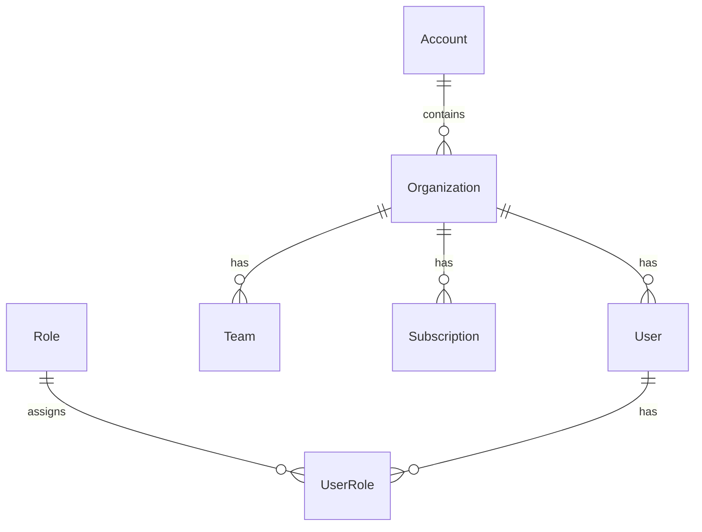

# Product Document — Headless SaaS API

## Summary
Backend exposes multi-tenant building blocks for a headless SaaS: **Accounts → Organizations → Users/Teams + Subscriptions**.
Includes JWT auth, soft-deletion, pagination, filtering, and auto-generated OpenAPI docs.

## ERD (mermaid)

